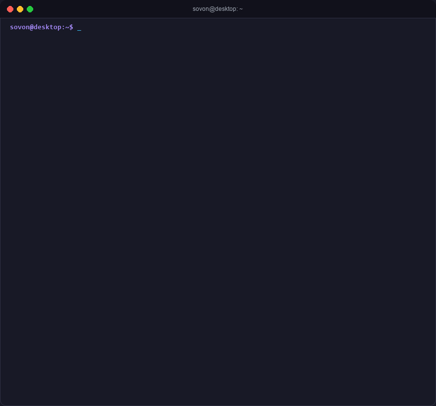
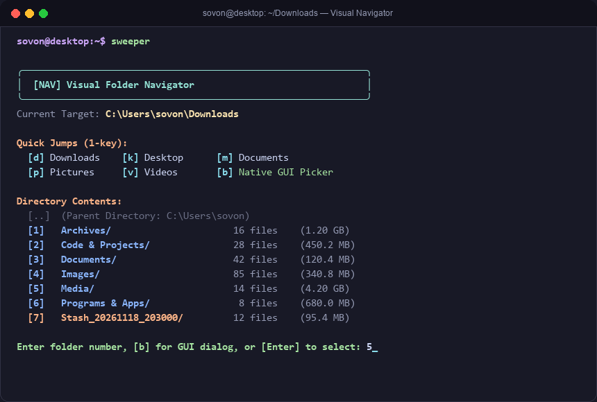
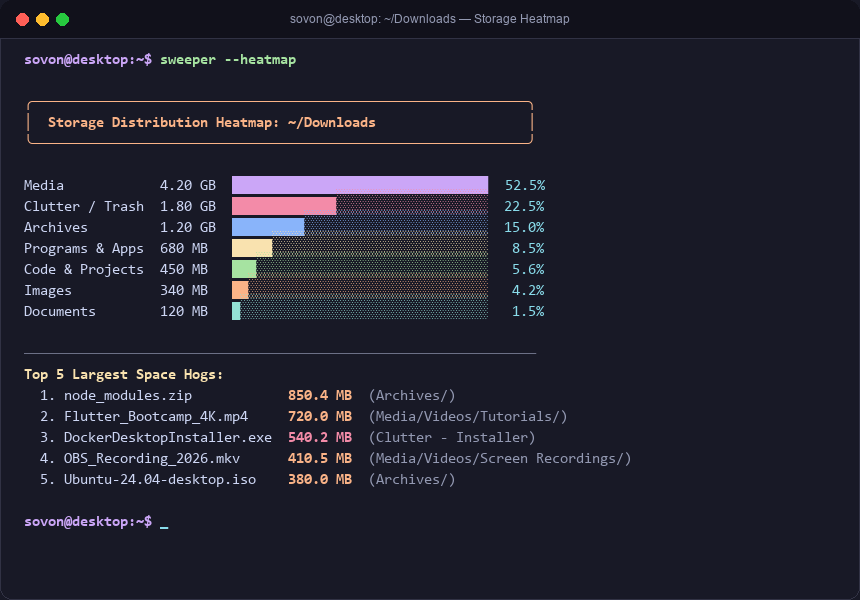

<div align="center">

# 🧹 sweeper

**Fast, zero-dependency folder organizer and clutter pruning engine.**

Categorize loose files, prune duplicate downloads, stash messy desktops for meetings, and monitor folders in the background.

[](https://github.com/sovon1/sweeper/releases)
[](LICENSE)
[](https://www.python.org/)
[](#architecture)
[](#installation)

<br/>

```
   ____                                   
  / ___|_      _____  ___ _ __   ___ _ __ 
  \___ \ \ /\ / / _ \/ _ \ '_ \ / _ \ '__|
   ___) \ V  V /  __/  __/ |_) |  __/ |   
  |____/ \_/\_/ \___|\___| .__/ \___|_|   
                         |_|   v1.0.0
```

</div>

<p align="center">
  
</p>

---

## Quickstart

Run directly without cloning or manual setup:

### Windows (PowerShell)
```powershell
irm https://raw.githubusercontent.com/sovon1/sweeper/main/run.ps1 | iex
```

### macOS & Linux
```bash
curl -fsSL https://raw.githubusercontent.com/sovon1/sweeper/main/run.sh | bash
```

### Astral uv / Python
```bash
# Run instantly with uv (zero install)
uvx sweeper-cli

# Or install via pip
pip install sweeper-cli
sweeper
```

---

## Why Sweeper?

| Feature | Manual Organizing | Typical Cleaners | `sweeper` |
| :--- | :---: | :---: | :---: |
| **Startup Time** | Slow | 1.5s – 4.0s (Electron/Node) | **< 20 ms** |
| **External Dependencies** | — | 50+ packages | **0 (Standard Library only)** |
| **Data Safety** | Accidental deletes | Permanent hard delete | **OS Trash / Recycle Bin** |
| **1-Click Undo** | None | Rare | **Atomic Transaction Ledger** |
| **Duplicate Iterations** | Manual comparison | Simple name match | **Cluster analysis + Chunk hash** |
| **Background Automation** | Cron scripts | Heavy background daemons | **Lightweight polling watch mode** |
| **Subtitles Pairing** | Separates video & subs | Ignored | **Companion auto-routing** |

---

## Core Capabilities

### 1. Interactive Sweep & Visual Folder Tree
Run `sweeper` without flags to launch the interactive terminal interface. Scan any directory, preview the categorization plan, inspect detected clutter, or press `c` to launch the **built-in visual directory navigator** with 1-key jumps (`d` for Downloads, `k` for Desktop, `m` for Documents) and native OS dialog integration (`b`).

<p align="center">
  
</p>

### 2. Media Intelligence Engine
Separates video and audio into dedicated category trees and applies pattern recognition:
* **Movies & Shows:** Releases tagged with resolution or encode identifiers (`1080p`, `4K`, `WEB-DL`, `HDR`, `x265`, `S01E02`) ➜ `Media/Videos/Movies & Shows/`
* **Tutorials & Courses:** Coding courses, lectures, workshops, masterclasses ➜ `Media/Videos/Tutorials & Courses/`
* **Screen Recordings:** OBS, Zoom, Loom, and system captures ➜ `Media/Videos/Screen Recordings/`
* **Audio & Speech:** Distinguishes songs (`Media/Audio & Music/Songs/`) from speech and podcasts (`Media/Audio & Music/Podcasts & Voice/`).
* **Companion Subtitle Pairing:** `.srt`, `.vtt`, and `.ass` files automatically follow their matching video file into the same destination directory.

### 3. Smart Semantic Sub-Tagging
Files are analyzed for contextual keywords and sorted into dedicated subdirectories:
* `invoice_oct26.pdf`, `receipt_01.png` ➜ `Documents/Invoices & Receipts/`
* `sovon_resume_2026.docx`, `cv.pdf` ➜ `Documents/Resumes & CVs/`
* `lecture_04.pdf`, `exam_routine.txt` ➜ `Documents/Study & Lecture Notes/`
* `Screenshot_2026.png` ➜ `Images/Screenshots/`
* `wallpaper_1920x1080.jpg` ➜ `Images/Wallpapers/`

### 4. Background Watch Mode (`--watch`)
Monitors your target directory for incoming files. Sweeper waits for active browser downloads to finish (verifying file stability and ignoring temporary `.crdownload` / `.tmp` files) and auto-sorts them immediately:
```bash
sweeper --watch
```

### 5. Presentation / Meeting Desktop Stash (`--stash`)
Instantly clean up a cluttered workspace before screen-sharing or presenting:
```bash
# Sweep all loose files into a timestamped Stash folder in 0.1s
sweeper ~/Desktop --stash

# Restore everything back to its exact position after the call
sweeper ~/Desktop --unstash
```

### 6. Storage Heatmap & Space Hogs (`--heatmap`)
Visualizes disk space distribution by category with an ASCII bar chart and ranks the **Top 10 Largest Space Hogs**:
```bash
sweeper --heatmap
```

<p align="center">
  
</p>

### 7. Content-Hash Duplicate Detection (`--find-duplicates`)
Identifies identical duplicate files across your folder even when they have completely different filenames using fast two-tier chunk hashing (MD5 on header and footer chunks).

---

## CLI Reference

```text
Usage: sweeper [PATH] [OPTIONS]

Positional Arguments:
  path                        Directory to inspect (default: ~/Downloads)

Execution Modes:
  --watch                     Run in background watch mode to auto-sweep completed downloads
  --heatmap, --stats          Display ASCII storage heatmap and Top 10 Space Hogs
  --find-duplicates           Scan for byte-for-byte identical files via content hash
  --stash                     Sweep loose desktop files into a timestamped Stash folder
  --unstash                   Restore files from the most recent Stash folder
  --dry-run                   Preview all proposed operations without moving any files
  --undo                      Reverse the last sweep operation and restore file locations

Filtering & Structure:
  --by-date                   Group files into Year-Month subfolders (e.g. Images/2026-11/)
  --organize-only             Sort loose files into categories without recycling clutter
  --clean-only                Prune duplicates and dead installers without moving other files

System & Configuration:
  --init-config               Generate a .sweeper.json configuration template
  --install-context-menu      Add 'Sweep with Sweeper' to Windows File Explorer right-click menu
  --uninstall-context-menu    Remove 'Sweep with Sweeper' from Windows File Explorer menu
  -y, --yes                   Non-interactive execution (skip confirmation prompts)
  -v, --version               Show version and exit
  -h, --help                  Show help message and exit
```

---

## Configuration (`.sweeper.json`)

Sweeper works with zero configuration, but power users can customize rules by creating a `.sweeper.json` file in the target directory or in `~/.sweeper.json`:

```bash
sweeper --init-config
```

```json
{
  "$schema": "https://raw.githubusercontent.com/sovon1/sweeper/main/schema.json",
  "by_date": false,
  "ignore": [
    "node_modules",
    ".git",
    "Important_*",
    "*.keep"
  ],
  "custom_categories": {
    "Books & Comics": {
      "icon": "📚",
      "exts": [".epub", ".mobi", ".azw3", ".cbr", ".cbz"],
      "dir_keywords": ["book", "comic", "manga"]
    },
    "3D Assets": {
      "icon": "🎨",
      "exts": [".blend", ".obj", ".stl", ".fbx", ".gltf"],
      "dir_keywords": ["model", "render", "mesh"]
    }
  }
}
```

---

## Safety Architecture

1. **Non-Destructive Deletions:** Sweeper **never** executes permanent unrecoverable file deletions. Clutter files, dead installers, and duplicate iterations are dispatched to the native operating system's Recycle Bin (Windows `SHFileOperationW`) or Trash (macOS / Linux XDG).
2. **Atomic Undo Ledger:** Every organization operation writes a transaction record to `.sweeper_history.json`. Executing `sweeper --undo` reverses operations in reverse chronological order and removes empty category directories.
3. **Collision Avoidance:** Sweeper never overwrites target files. If a file named `notes.txt` already exists in `Documents/`, the incoming file is safely renamed to `notes_1.txt`.
4. **Protected System Entities:** Operating system files (`desktop.ini`, `.DS_Store`, `thumbs.db`), desktop shortcuts (`.lnk`, `.url`), revision control trees (`.git`), and configuration files are excluded from movement or modification.

---

## Performance

* **Zero External Dependencies:** Built strictly on the Python Standard Library (`pathlib`, `shutil`, `ctypes`, `hashlib`, `argparse`).
* **Cold Startup:** < 20 milliseconds.
* **Memory Footprint:** < 15 MB resident set size.
* **Non-Blocking I/O:** Directory size calculation employs shallow traversal guards to prevent hanging on deep development trees (e.g., `node_modules`, `.venv`).

---

## Automated Test Suite

Sweeper includes an automated unit test suite covering classification, duplicate clustering, subtitle companion routing, stash/unstash lifecycle, collision resolution, and atomic undo:

```bash
python -m unittest discover -s tests
```

---

## License

Distributed under the [MIT License](LICENSE).
